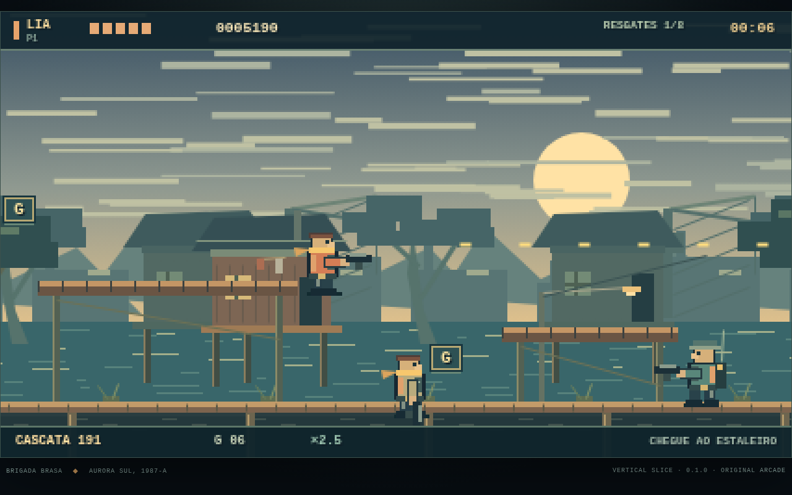

# BRASA DE AÇO — OPERAÇÃO HORIZONTE

**Vertical slice jogável · v0.1.0 · Missão 1: Fogo no Mangue**

Um run-and-gun 2D original sobre uma brigada de pilotos e mecânicos no arquipélago de Aurora Sul. Pixel art procedural, música e efeitos sintetizados em tempo real, sem downloads de assets ou CDNs. Não é uma reprodução de Metal Slug; não usa conteúdo da SNK.

**Jogar:** https://luispauloalves500.github.io/brasa-de-aco/



## O que esta versão entrega

- Missão autoral com praia, passarelas, bifurcação Palafitas/Canais, oficina, trecho de blindado e cais militar.
- Lia Torv e Bento Arcos, com vantagens pequenas de troca de arma/proteção do veículo.
- Pistola M-7 infinita como fallback; Cascata, Cobalto e Faísca com munição limitada; dois slots especiais; granadas em arco e corpo a corpo contextual.
- Seis inimigos: recruta, escudeiro, granadeiro, rádio com reforço, torre e blindado Chacal.
- Besouro-9 pilotável: tiro direcional, obus, salto, avaria, janela de ejeção, entrada/saída. É possível terminar a pé.
- Balde de Ferro e Dragão-Guindaste, com avisos de ataque, fases, painel auxiliar, núcleo exposto e destruição.
- Oito resgates por percurso, três segredos, caixas/barris destrutíveis, score e Ímpeto.
- Checkpoint inicial e dois checkpoints de percurso; continue; save local com checksum e dois backups. Recompensas registradas não são duplicadas após morte.
- Menu/hangar animado, personagem/dificuldade, briefing, objetivos, pausa, controles remapeáveis, opções, resultado, epílogo e créditos.
- PT-BR/EN, teclado e Gamepad API; Recruta/Veterano/Lenda; volume por bus, mono, tremor, movimento/flashes reduzidos, mira assistida e escudo opcional. Assistências usam recordes separados.
- Quatro cues musicais originais — hangar, missão, chefe e vitória — e efeitos de armas, impactos, explosões, resgate e interface.

**Não é a versão 1.0 completa do GDD.** Missões 2–8, finais A/B da campanha, quatro heróis, arsenal/veículos completos, coop local/online, dublagem gravada, port nativo, desafios, galeria/jukebox e certificação integral permanecem fora desta entrega. O epílogo fecha a operação da Baía Cobre, não a campanha inteira. A meta de 60 FPS ainda precisa de validação em máquinas reais; os testes de timestep não são uma certificação de desempenho.

## Controles

| Ação | Teclado | Gamepad padrão |
|---|---|---|
| Andar | A/D ou ←/→ | Analógico / direcional |
| Mirar alto e diagonal | W/↑ + direção | Analógico / direcional |
| Agachar | S/↓ | Baixo |
| Tiro / melee contextual | J (segurar) | X / □ |
| Pulo variável | K / espaço | A / × |
| Granada / obus do veículo | L | B / ○ |
| Trocar arma (inclui pistola) | Q | Y / △ |
| Libertar / rota / veículo / painel | E | RB |
| Esquiva curta | Shift | RT |
| Pausa | Esc / P | Menu |
| Objetivos | Tab | View |

Teclas podem ser remapeadas nas opções; as setas e espaço permanecem como alternativas. Prompts compactos no mundo mostram as teclas padrão; consulte Controles após remapear. Gamepads variam conforme o mapeamento do navegador. Suporte físico precisa de playtest adicional. Há botões de toque auxiliares em dispositivos compatíveis, mas esta versão foi projetada para desktop/controle.

**Dicas:** inimigos anunciam os disparos; abaixe-se ou salte. Atire nos cadeados ou use E para resgatar. Na comporta, use E para escolher uma rota. Na oficina, derrote Balde de Ferro antes de pilotar Besouro-9. E sai da máquina, inclusive durante o aviso de ejeção. É possível vencer sem o tanque. Sino, árvore marcada e cofre têm segredos. O painel do chefe interrompe seu ciclo por alguns segundos.

O som é liberado ao clicar em um botão. A sessão pausa ao perder foco. Dados ficam apenas no navegador; limpar dados do site remove o progresso. Uma nova operação substituirá o checkpoint ativo, mantendo backups recentes. Save corrompido é preservado; iniciar nova operação permite criar um novo save. Não há conta, coleta de dados, publicidade, loja ou servidor de jogo.

## Executar localmente

Requer um servidor estático, não abrir `index.html` via `file://` (módulos ES).

```sh
python3 -m http.server 8087
# abrir http://localhost:8087/
```

Não existe etapa de build nem dependência em runtime. GitHub Pages publica `main`, diretório raiz. `.nojekyll` preserva a estrutura estática.

## Testes

```sh
npm test                 # Node 20+; 30 testes de lógica e campanha
npm run serve
# Outro terminal, Chromium headless isolado:
CHROME=/caminho/chrome-headless-shell bash tools/browser-qa.sh
```

O harness `tests/browser.html` usa `?qa=1` em um iframe da aplicação. Testa menus, retorno de overlays, rota/checkpoint, idiomas, recursos e execução simulada até epílogo/créditos. O bot usa combate e continues normais; os screenshots não representam playtest humano. A suíte de lógica reproduz praia → resultados pelas duas rotas, sem teleporte ou dano artificial. Gamepad físico, audição/mix, cinco execuções humanas solo/três coop e medição real de FPS **não foram certificados**.

Veja [ANALISE.md](ANALISE.md), [GDD completo](docs/GDD.md), [QA executado](docs/QA.md) e [notas da versão](docs/RELEASE_NOTES.md).
