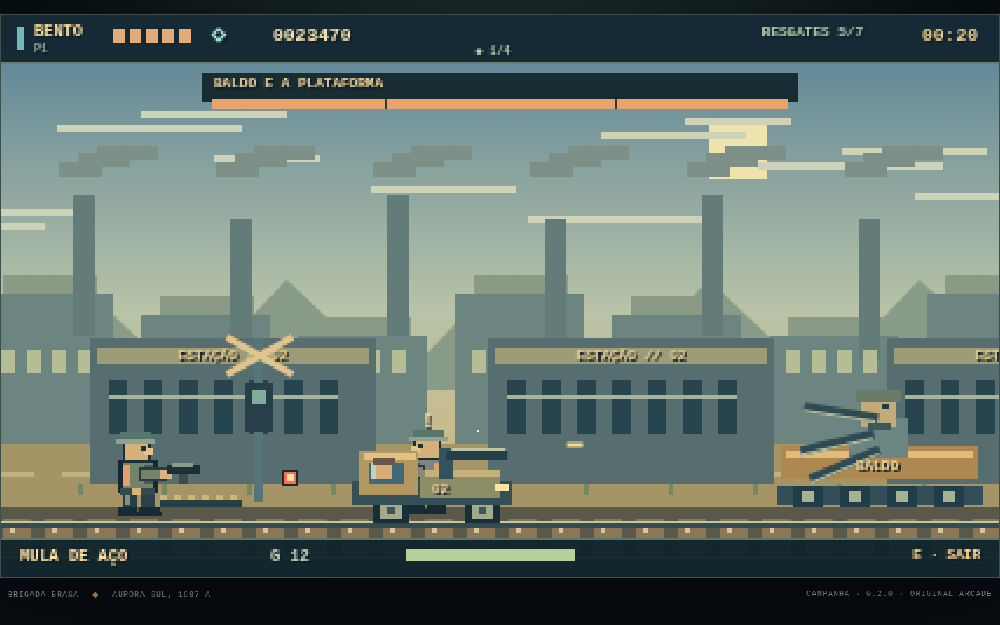

# BRASA DE AÇO — OPERAÇÃO HORIZONTE

**v0.2.0 · Duas missões jogáveis · Solo · PT-BR / EN**

Run-and-gun 2D original no arquipélago de Aurora Sul. Pixel art procedural, música e efeitos WebAudio originais, sem CDNs, conta ou servidor de partida. Não usa sprites, melodias ou gravações de jogos da SNK.

**Jogar:** https://luispauloalves500.github.io/brasa-de-aco/



## Campanha disponível

### 01 · Fogo no Mangue
Praia, palafitas/canais, oficina, Besouro-9 e cais. Oito resgates, três segredos, Balde de Ferro e Dragão-Guindaste. Lia Torv ou Bento Arcos; pistola M-7, Carabina Cascata, Espingarda Cobalto, Lança-foguetes Faísca, granadas e melee. Todos os sistemas da primeira versão permanecem disponíveis.

### 02 · Trilho Partido — NOVA
- Vila ferroviária em dois níveis, depósito de combustível, válvulas de vapor e explosões em cadeia.
- **Túnel de manutenção:** escudeiros, elite Cinza, engenheira e console do regulador.
- **Telhados das oficinas:** paraquedistas, atiradores e passarela móvel que carrega o jogador.
- Cruzamento com aviso de tráfego, **Mula de Aço** pilotável com metralhadora/minas e **Sargento Baldo e a Plataforma**.
- Embarque a pé em três vagões, com cenário/trilhos em movimento e colisões estáveis no referencial do trem. Há uma passarela inferior segura.
- **Locomotiva Moloch:** canhões danificáveis, três padrões, fases em 70%/30%, plataformas laterais que cedem com aviso e caldeira exposta/vapor com espaços seguros.
- Sete resgates; segredos na sinalização, relógio e vagão postal.
- Briefing e epílogo ilustrados/animados; novas falas originais PT-BR/EN.
- Três novas cues sintetizadas: **Rodas em Brasa**, **Sem Freios**, **Última Estação**.
- Engenheira + componente preservam o **primeiro regulador (1/4)** exigido pelo futuro Final B. O registro sobrevive a morte, continue e troca de missão. O Final B completo ainda não existe nesta versão.

A vitória na missão 1 libera a missão 2 e oferece acesso direto ao briefing seguinte. **Seleção de Missões** permite repetir capítulos liberados. Recordes válidos da versão anterior migram o desbloqueio da missão 1; checkpoints antigos continuam legíveis.

## Controles

| Ação | Teclado | Gamepad padrão |
|---|---|---|
| Andar | A/D ou ←/→ | Analógico / direcional |
| Mirar alto / diagonal | W/↑ + direção | Analógico / direcional |
| Agachar | S/↓ | Baixo |
| Tiro / melee contextual | J (segurar) | X / □ |
| Pulo variável | K / espaço | A / × |
| Granada; obus no Besouro; minas na Mula | L | B / ○ |
| Trocar arma (inclui pistola) | Q | Y / △ |
| Libertar / válvula / console / veículo | E | RB |
| Esquiva | Shift | RT |
| Pausa | Esc / P | Menu |
| Objetivos | Tab | View |

A Mula deve ser deixada com **E** antes dos vagões. Conserve foguetes com Q para enfrentar Moloch. Na rota do túnel, feche a válvula, liberte a engenheira e use E no console adiante. Resgates também podem ser liberados atirando nos cadeados.

Teclado remapeável nas opções; prompts compactos mostram as teclas padrão. Gamepad API com pausa na desconexão; compatibilidade física ainda precisa de playtest. Botões de toque auxiliares existem, mas o alvo de produção é desktop.

## Opções, áudio e saves

Três dificuldades, mira/escudo assistidos, melee opcional, volume mestre/música/SFX, mono, tremor e flashes/movimento reduzidos. Assistências separam os recordes. Música é liberada após interação. O jogo pausa ao perder foco.

Checkpoint e campanha ficam no navegador, sem envio a servidores. Saves têm checksum e backups; save inválido é preservado antes de uma nova operação. Limpar dados do site remove o progresso. Uma nova operação substitui o checkpoint ativo, mas não rebaixa capítulos já concluídos nem o registro de engenharia. Não há importação/exportação ou cloud save nesta versão.

## Escopo real

As duas missões são adaptações compactas e autorais do GDD, não uma campanha 1.0 certificada. A duração-alvo de 5–7 minutos por capítulo não foi validada em playtest humano; os bots percorrem M2 em aproximadamente 80–90 segundos no cenário de teste. O trem usa referencial relativo com rolagem do cenário, não uma câmera que empurra o jogador para perigos.

**Ainda fora:** missões 3–8, demais armas/veículos/heróis, finais A/B completos, coop local/online (a segunda vaga da Mula não é funcional), dublagem gravada, port nativo, galeria/jukebox, ranking online e certificação de 60 FPS em hardware real.

## Executar e testar

```sh
python3 -m http.server 8089
# abrir http://localhost:8089/
npm test  # Node 20+; 47 testes
```

Nenhum build ou dependência em runtime. Não abrir via `file://`, pois módulos ES precisam de servidor estático. Pages publica `main`, raiz, com `.nojekyll`.

```sh
BASE=http://127.0.0.1:8089 CHROME=/caminho/chrome-headless-shell bash tools/browser-qa.sh
BASE=http://127.0.0.1:8089 CHROME=/caminho/chrome-headless-shell bash tools/rail-browser-qa.sh
```

Os harnesses usam navegadores headless isolados e `?qa=1`, sem sessões pessoais. Bots usam inputs e regras normais; não substituem playtest humano. Leia [análise](ANALISE.md), [GDD original](docs/GDD.md), [implementação M2](docs/MISSAO-02.md), [QA](docs/QA.md), [publicação](docs/PUBLICACAO.md) e [changelog](docs/RELEASE_NOTES.md).
